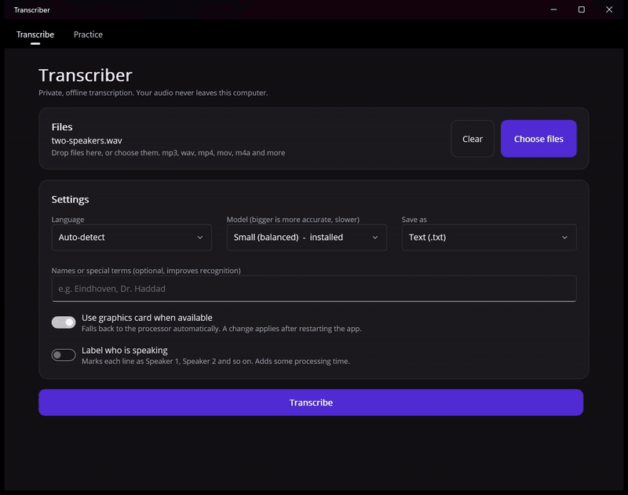
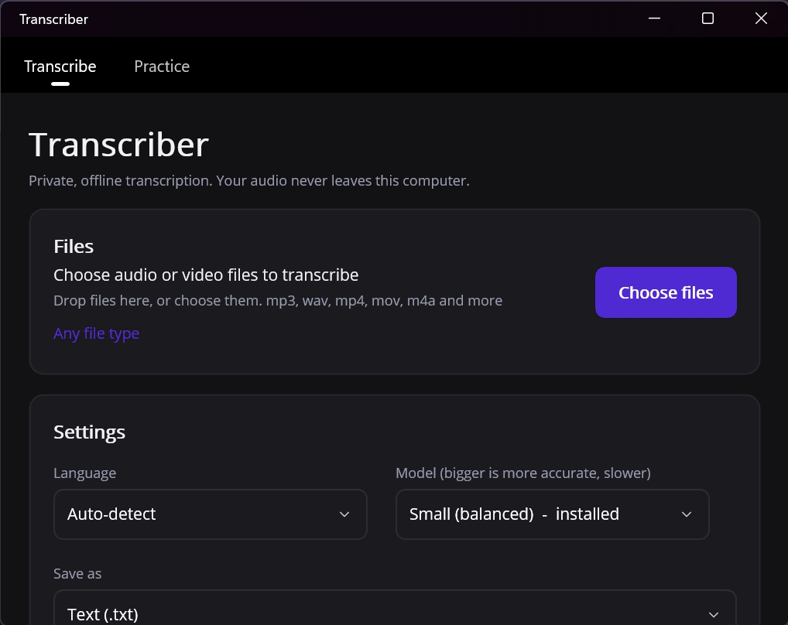

# Transcriber

**Private, offline speech tools for your desktop.** Turn recordings into timestamped transcripts, or practise speaking and see how to improve. Everything runs on your own computer: your audio is never uploaded, and nothing needs to be installed or downloaded first.

[](https://github.com/Eomar21/transcriber/actions/workflows/ci.yml)
[](https://github.com/Eomar21/transcriber/releases/latest)
[](LICENSE)
-lightgrey)

Transcriber has two modes, each on its own tab:

| | **Transcribe** | **Practice** |
| --- | --- | --- |
| For | Getting the words out of audio and video | Improving how you speak |
| You give it | One or more recordings | A recording of yourself, or a live microphone take |
| You get | A transcript with timestamps and optional speaker labels, saved as text, subtitles or JSON | Pace, pauses, filler words and stumbles, plain-language tips, and your progress over time |

**Full documentation: [eomar21.github.io/transcriber](https://eomar21.github.io/transcriber/)** with guides for each mode, speaker labels, output formats, privacy, troubleshooting and an FAQ.

Both use [OpenAI Whisper](https://github.com/openai/whisper) through [Whisper.net](https://github.com/sandrohanea/whisper.net), running locally.

## Contents

- [Transcribe mode](#transcribe-mode)
- [Practice mode](#practice-mode)
- [Get it](#get-it)
- [Privacy](#privacy)
- [How it works](#how-it-works)
- [Troubleshooting](#troubleshooting)
- [Build from source](#build-from-source)
- [Project layout](#project-layout)
- [Testing](#testing)
- [Licences and notices](#licences-and-notices)

---

## Transcribe mode



Drop in audio or video and get a transcript, without sending it anywhere.

### What it does

- **Many formats.** 36 audio and video formats, including mp3, wav, m4a, flac, opus, wma, mp4, mov, mkv, webm and avi. Video files have their audio extracted automatically, and a wav or mp3 that the built-in decoder rejects is read with the bundled ffmpeg. See the [supported formats](https://eomar21.github.io/transcriber/supported-formats) for the full list and what cannot be read.
- **Languages chosen for accuracy.** The built-in Small model offers English, Spanish, Portuguese, Italian, German and Dutch, plus auto-detect. Dutch shows a hint to use the Medium model for better results. Larger models add French, Polish, Turkish, Indonesian, Swedish and Ukrainian. A recording that mixes languages can lose the minor language, and the app warns when speech looks missing.
- **Batch.** Select several files and transcribe them in one run.
- **Four output formats.** Plain text (`.txt`), subtitles (`.srt`, `.vtt`) or JSON with timestamps. The transcript is saved next to the source file as `<name>_transcript.<ext>`.
- **Speaker labels.** Optionally marks each line as Speaker 1, Speaker 2 and so on, in the list and in every export. Tell it how many people speak, or let it work that out.
- **Click to listen.** Click any line to hear the recording from that moment. A player bar lets you stop it.
- **Search and copy.** Search inside the transcript, copy it all, or open the saved file and reveal it in Explorer or Finder with one click.
- **Names and terms.** An optional hint field for names or jargon (for example "Eindhoven, Dr. Haddad") improves recognition of words Whisper would otherwise guess.
- **Model choice.** The default model is bundled. Larger, more accurate models (and a faster, smaller one) can be downloaded on demand from the model list.
- **GPU acceleration.** Uses your graphics card through Vulkan when available and falls back to the processor automatically.
- **Cancel anytime.** Long runs can be stopped.

### Using it

1. Drop files on the window, or choose them with **Choose files**. You can also pass a file on the command line.
2. Pick the language (or leave it on auto-detect), the model and the output format.
3. Optionally turn on **Label who is speaking** and choose how many people speak.
4. Press **Transcribe**. The page scrolls to the progress bar. A small runner moves along it. One bar covers all the files, and sparks show at the end. The result appears below with the saved path.

### Speaker labels, in short

A bundled model finds where speech changes hands, another describes each voice, and clustering groups the pieces by voice. Each transcript line gets the speaker who talks for most of it. It works best with clearly separated voices and little crosstalk. If the automatic count is off, set the number of speakers yourself.

### Output formats

| Format | Speaker labels appear as |
| --- | --- |
| `.txt` | `Speaker 1: text` at the start of each line, with a timestamp |
| `.srt` | `Speaker 1: text` inside each subtitle |
| `.vtt` | The WebVTT voice tag `<v Speaker 1>` |
| `.json` | A `speaker` field on each segment |

---

## Practice mode



Rehearse a talk, an interview answer or a presentation, then see how you did. Nothing leaves your computer.

### What it does

- **Record or choose a file.** Press **Record** to speak into the microphone, or **Choose file** to analyse an existing audio or video file.
- **Five measures.** Pace, filler words, pauses, stumbles and length (see below).
- **Tips in plain language.** Each result comes with advice marked with a symbol (a tick for good, an exclamation mark for something to work on, an "i" for information), so it does not rely on colour alone.
- **Progress over time.** Each run of at least 25 words is saved. The next run is compared with your last one in the same language, for example "Fewer fillers than last time".
- **What was heard.** The full transcript is shown so you can check the numbers against your actual words.
- **Optional written feedback.** If you run [Ollama](https://ollama.com) on your computer, pick one of your models and get a short written review as well. It is optional and also local.
- **Languages.** English, Spanish and Dutch (Dutch is less accurate with the built-in Small model, so a hint shows).

### Using it

1. Open the **Practice** tab.
2. Press **Record**, speak, and press **Stop**. The level bar shows the microphone is picking you up. Or press **Choose file**.
3. Pick the language you spoke.
4. Press **Analyse my speaking**.
5. Read the tiles and tips. Past runs are listed under **Your progress**, where you can delete one or clear them all.

### What is measured

| Measure | How it is worked out | What counts as good |
| --- | --- | --- |
| **Pace** | Words per minute of the time you were actually speaking, not counting long silences. | 120 to 160 words per minute is easy to follow. The tips flag under 110 as slow and over 170 as fast. |
| **Filler words** | Fillers per 100 words, from a word list for each language: English, Spanish, Portuguese, Italian, German and Dutch ("um", "uh", "ehm", "äh", "este" and so on). "Like" is only counted when it is set apart by commas, so "I like cats" is never flagged. | 2 or fewer per 100 words is clean. More than 5 is worth working on. |
| **Pauses** | Gaps of 0.8 seconds or more between lines. Reported as a count and the longest gap. | A few pauses help listeners. More than about 6 a minute reads as hesitation. |
| **Stumbles** | Repeated words ("the the") and stuttered starts ("b-b-because"). Emphasis ("very, very") and single letters are not counted. | None is ideal. |
| **Length** | Duration and word count. | |

Very short recordings (under 25 words) are analysed but not saved to your history, because the numbers would be too noisy to compare.

### Recording details

- Recordings are saved as 16 kHz mono wav and are used directly, with no conversion.
- Anything under one second is treated as an accidental click and discarded.
- A recording stops by itself after 30 minutes, so a forgotten one cannot fill your disk.
- If no sound arrives for about three seconds, a warning tells you to check that the microphone is connected, not muted and allowed in your system's privacy settings. A blocked microphone usually records silence instead of reporting an error, so this warning is the only sign you would get.
- Your recording is kept while you work with it (for example, to analyse again in another language) and deleted when you record again or choose another file. Files you choose yourself are never touched. Leftover recordings older than a day are removed when the app starts.
- On macOS the system asks for microphone permission the first time. You can change it later in System Settings, Privacy and Security, Microphone.

### How fillers are kept in the transcript

Whisper normally tidies "um" and "uh" out of what it writes, which would hide exactly what this mode measures. Practice mode transcribes with a prompt written to keep fillers and stutters, and uses the `small` model. The **What was heard** box shows the result, so you can see which words were kept. Filler counts are only as good as that transcript.

### Written feedback with Ollama

Install Ollama, download any model it offers, and reopen the Practice tab. The app finds your models automatically, and **Get written feedback** sends your transcript and measures to Ollama on `localhost:11434`. If Ollama is not running, the tab says so and everything else keeps working. Nothing is sent to anyone else.

### Where your history is stored

Your practice history is a small JSON file on your computer, `practice-history.json`, in the app's local data folder (on Windows, `%LOCALAPPDATA%\Transcriber`). It holds the measures for each run and the title, not your audio.

---

## Get it

Download the latest build from the [Releases page](../../releases/latest).

| Platform | Download | Notes |
| --- | --- | --- |
| Windows 10/11 (x64) | `Transcriber-<version>-win-x64-setup.exe` | Installer. A portable `.zip` is also available: unzip and run `Transcriber.Maui.exe`. |
| macOS (Apple Silicon) | `Transcriber-<version>-mac-arm64.dmg` | Open the image and drag Transcriber to Applications. |

The downloads are large (about 550 MB) because they include the Whisper model, so nothing is downloaded on first launch.

The builds are not code signed yet. On Windows, SmartScreen may show a warning: choose **More info**, then **Run anyway**. On macOS, right-click the app and choose **Open** the first time.

Intel Macs are not supported: the macOS build is for Apple Silicon (M1 and later) only.

### What is included

ffmpeg, the default Whisper model, the voice activity model and the two speaker models are all inside the app. On macOS the speaker detection runs as a bundled helper program, because the Mac app cannot load the library the Windows build uses.

## Privacy

- Transcription, speaker detection, speech analysis and recording all happen on your computer.
- The app makes no network connections for its work. The only optional one is to Ollama on your own machine (`localhost`), if you use written feedback. Models you choose to download from the model list are fetched from their public host once.
- Recordings stay on your disk. Practice history stores numbers and titles, not audio.

## How it works

1. **Read.** MP3 and WAV are decoded in-process. Other formats go through the bundled ffmpeg, which extracts a 16 kHz mono track.
2. **Find the speech.** A bundled Silero voice activity model locates where people are talking, so silence and background noise never reach Whisper.
3. **Transcribe.** Whisper runs locally on those stretches, producing segments with start and end times. Obvious Whisper hallucinations are filtered out.
4. **Label speakers (optional).** Bundled segmentation and voice-embedding models work out who speaks when, and each line gets the speaker who talks for most of it.
5. **Save or analyse.** In Transcribe mode the transcript is written next to the source file. In Practice mode the same transcript is measured for pace, fillers, pauses and stumbles and turned into tips.

Other Whisper models are stored in `%LOCALAPPDATA%\Transcriber\models` on Windows.

## Troubleshooting

| Problem | What to try |
| --- | --- |
| Windows shows a SmartScreen warning | The app is not signed yet. Choose **More info**, then **Run anyway**. |
| macOS says the app cannot be opened | Right-click the app, choose **Open**, then confirm. |
| The speaker option is missing | It appears only when the speaker models and helper are present in the app. Reinstall from the release download. |
| Speaker labels split one person in two (or merge two people) | Set the number of speakers yourself instead of using automatic detection. |
| Practice shows a "no sound" warning | Check the microphone is connected and unmuted, and allowed in Windows Settings (Privacy and security, Microphone) or macOS System Settings. |
| Practice says no microphone was found | Connect one, or use **Choose file** with a recording made elsewhere. |
| The filler count is 0 but you said "um" | Whisper may have dropped it. Check **What was heard**. A clearer recording helps. |
| Written feedback is not offered | Start Ollama, download a model, and reopen the Practice tab. |
| Transcription is slow | Turn on the graphics card option, or choose a smaller model. Longer files take longer. |

## Build from source

Requirements: the [.NET 10 SDK](https://dotnet.microsoft.com/download) and, for the app, the MAUI workload.

```bash
# Run the tests (fast ones, no model needed)
dotnet test source/Transcriber/Transcriber.Tests --filter "FullyQualifiedName!~TranscriptionTests"

# Build and run the Windows app
dotnet workload install maui-windows
dotnet run --project source/Transcriber/Transcriber.Maui -f net10.0-windows10.0.19041.0
```

The first build downloads ffmpeg and the models (about 600 MB in total). Everything is pinned to exact versions and verified by SHA-256, then cached in the project's `obj` folder. The macOS build also fetches sherpa-onnx's speaker detection tool.

## Project layout

| Project | Purpose |
| --- | --- |
| `Transcriber.Services` | Audio, video, Whisper, speech detection, speaker detection, model management and export. No UI dependencies. The classes are internal. The public parts are the interfaces and models. One call, `AddTranscriberServices()`, registers them. Default settings are in `appsettings.json`. A user file can change them: see [Settings file](https://eomar21.github.io/transcriber/settings). |
| `Transcriber.Coach` | Speech analysis for Practice mode: pace, pauses, filler words, stumbles, tips, history, optional Ollama feedback. No UI dependencies. Interfaces, models, exceptions and services each have their own folder. Each language is a JSON profile in `Languages/Profiles`, so a new language needs a data file and no code. |
| `Transcriber.ViewModels` | MVVM view models (CommunityToolkit.Mvvm). Each screen has one coordinator view model. It owns one view model for each section of the screen: `Transcribe/` has Files, Options, Status, Saved, Playback and Results, and `Practice/` has Source, Microphone, Analysis, History and Feedback. The sections share one state object and tell each other about changes through events. Platform services such as file pickers, playback and the microphone are small interfaces. |
| `Transcriber.Maui` | The .NET MAUI app. Each section has its own view in `Views/Transcribe` and `Views/Practice`. The page only places the views. `Resources/Styles` has the spacing scale and the shared control styles. Platform code is in `Platforms/Windows` and `Platforms/MacCatalyst`. |
| `Transcriber.Tests` | xUnit tests, including end-to-end transcription of real recordings. |
| `Transcriber.UiTests` | Drives the real Windows app through UI Automation. |
| `build/` | MSBuild targets that fetch and verify the bundled tools and models. |

## Testing

- **Unit tests** cover the analysis library, the view models (including recording, with a fake microphone), export formats, speaker assignment and the parsers.
- **End-to-end tests** transcribe real recordings in English, Dutch, Arabic and Spanish (including video containers) and compare the result with a reference text using word error rate, with a threshold per language. There are also real-model tests for speech detection, speaker labelling and the full Practice analysis. Set `TRANSCRIBER_TEST_CPU=1` to force CPU, or `TRANSCRIBER_TEST_MODEL=<id>` to test another model. The recordings and their sources are listed in `Transcriber.Tests/TestData/README.md`.
- **UI tests** start the built Windows app and drive it: transcribing a file, labelling speakers, click-to-listen, and switching between the two tabs.
- **macOS build checks** verify the app bundle contains everything it needs and run the bundled speaker detection program on a two-person recording.

Continuous integration runs the tests and builds the app on every push. Pushing a `v*` tag builds a release and publishes it to GitHub Releases.

## Licences and notices

- Transcriber source: MIT, see [LICENSE](LICENSE).
- Whisper and the ggml models: MIT, by OpenAI and the whisper.cpp project.
- Voice activity detection uses the [Silero VAD](https://github.com/snakers4/silero-vad) model (MIT). Speaker labels use [sherpa-onnx](https://github.com/k2-fsa/sherpa-onnx) (Apache 2.0, with ONNX Runtime, MIT; on macOS its command-line tool is bundled and run as a separate program) with the pyannote segmentation 3.0 model (MIT) and the 3D-Speaker CAM++ embedding model (Apache 2.0).
- **ffmpeg** is bundled unmodified as a separate executable from [eugeneware/ffmpeg-static](https://github.com/eugeneware/ffmpeg-static) (release b6.1.1). The Windows build is licensed under the GPL. Its licence text ships in the app's `licenses` folder, and the source is available from [ffmpeg.org](https://ffmpeg.org/download.html#get-sources).
- The progress bar uses [SkiaSharp](https://github.com/mono/SkiaSharp) and SkiaSharp.Extended (MIT). The runner, the surfer and the sparks are original pixel art. `tools/sprites/sprites.cs` draws them. Each run shows a random look (a sprite with its own bar colours). To add a look, see `ProgressLooks.cs` in the ViewModels project.
