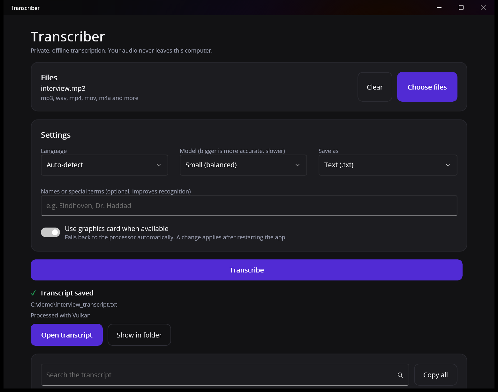

# Transcriber

Private, offline speech-to-text for your desktop. Drop in an audio or video file and get a timestamped transcript, without uploading anything. Everything runs on your own computer using [OpenAI Whisper](https://github.com/openai/whisper) through [Whisper.net](https://github.com/sandrohanea/whisper.net).



## Features

- **Fully offline.** Your audio never leaves your computer.
- **Nothing to install.** ffmpeg and the default Whisper model are bundled with the app. It works on first launch with no downloads.
- **Many formats.** mp3, wav, mp4, mov, avi, mkv, webm, m4a, flac, ogg and aac. Video files have their audio extracted automatically.
- **Many languages.** Automatic language detection, or pick one. Tested with English, Dutch, Arabic and Spanish.
- **Several output formats.** Save as plain text (.txt), subtitles (.srt, .vtt) or JSON with timestamps.
- **Batch.** Select several files and transcribe them in one run.
- **Better names and terms.** Optional hint field for names or jargon, which improves recognition.
- **GPU acceleration.** Uses your graphics card through Vulkan when available and falls back to the processor automatically.
- **Search and copy.** Search inside the transcript, copy it all, or open the saved file and reveal it in Explorer or Finder with one click.
- **Cancel anytime.** Long runs can be stopped.

## Get it

Download the latest build from the [Releases page](../../releases).

| Platform | Status |
| --- | --- |
| Windows 10/11 (x64) | Unzip and run `Transcriber.Maui.exe`. |
| macOS | Planned. The app is built for Mac Catalyst but there is no release yet. |

The Windows download is large (the model alone is 488 MB) because it includes the Whisper model, so no first-run download is needed.

## How it works

1. **Read.** MP3 and WAV are decoded in-process. Other formats go through the bundled ffmpeg, which extracts a 16 kHz mono track.
2. **Transcribe.** Whisper (the `small` model by default) runs locally, producing segments with start and end times. Obvious Whisper hallucinations on silence are filtered out.
3. **Save.** The transcript is written next to the source file as `<name>_transcript.<ext>`.

Other models (larger and more accurate, or smaller and faster) can be downloaded on demand and are stored in `%LOCALAPPDATA%\Transcriber\models`.

## Build from source

Requirements: the [.NET 10 SDK](https://dotnet.microsoft.com/download) and, for the app, the MAUI workload.

```bash
# Run the tests (fast ones, no model needed)
dotnet test source/Transcriber/Transcriber.Tests --filter "FullyQualifiedName!~TranscriptionTests"

# Build and run the Windows app
dotnet workload install maui-windows
dotnet run --project source/Transcriber/Transcriber.Maui -f net10.0-windows10.0.19041.0
```

The first build downloads ffmpeg and the Whisper model (about 570 MB in total). Both are pinned to exact versions and verified by SHA-256, then cached in the project's `obj` folder.

## Project layout

| Project | Purpose |
| --- | --- |
| `Transcriber.Services` | Audio, video, Whisper, model management and export. No UI dependencies. |
| `Transcriber.ViewModels` | MVVM view models (CommunityToolkit.Mvvm) behind small interfaces for platform services. |
| `Transcriber.Maui` | The .NET MAUI app: pages, styles and platform implementations. |
| `Transcriber.Tests` | xUnit tests, including end-to-end transcription of real recordings. |
| `build/` | MSBuild targets that fetch and verify the bundled ffmpeg and model. |

## Testing

Besides unit tests, the end-to-end tests transcribe real recordings in English, Dutch, Arabic and Spanish (including video containers) and compare the result with a reference text using word error rate, with a threshold per language. Set `TRANSCRIBER_TEST_CPU=1` to force CPU, or `TRANSCRIBER_TEST_MODEL=<id>` to test another model. The recordings and their sources are listed in `Transcriber.Tests/TestData/README.md`.

Continuous integration runs the tests and builds the app on every push. Pushing a `v*` tag builds a release and publishes it to GitHub Releases.

## Licences and notices

- Whisper and the ggml models: MIT, by OpenAI and the whisper.cpp project.
- **ffmpeg** is bundled unmodified as a separate executable from [eugeneware/ffmpeg-static](https://github.com/eugeneware/ffmpeg-static) (release b6.1.1). The Windows build is licensed under the GPL. Its licence text ships in the app's `licenses` folder, and the source is available from [ffmpeg.org](https://ffmpeg.org/download.html#get-sources).
